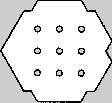
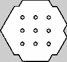
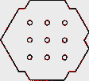
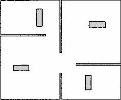
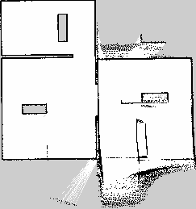
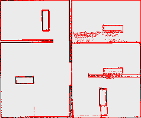

# LTRB_GK — Báo cáo so sánh hai cấu hình SLAM Toolbox

## Mục tiêu

Đánh giá khác biệt giữa hai cấu hình `slam_toolbox` cho TurtleBot3 Burger trong
Gazebo Harmonic. Mỗi lượt dùng lidar 2D `/scan`, odometry Gazebo và cùng độ
phân giải map 0,05 m/ô. Map được lưu bằng `nav2_map_server/map_saver_cli` và
so sánh bằng `tb3_slam_map_analysis/compare_maps`.

Thí nghiệm gồm **hai world độc lập**. Trong mỗi world, robot chạy một lượt với
baseline và một lượt với high-fidelity, rồi mới so sánh hai map của chính
world đó. Vì hình học và kích thước của hai world khác nhau, tỷ lệ sai khác
giữa lượt 1 và lượt 2 không được dùng để xếp hạng trực tiếp chất lượng map.

Hai profile được dùng:

| Profile | File cấu hình |
| --- | --- |
| Baseline | `tb3_slam_map_analysis/config/slam_baseline.yaml` |
| High-fidelity | `tb3_slam_map_analysis/config/slam_high_fidelity.yaml` |

`difference.ppm` quy ước: **đỏ** là ô một map xem là vật cản và map kia xem
là free; **trắng nhạt** là free giống nhau; **đen** là vật cản giống nhau;
**xám** là unknown hoặc nằm ngoài vùng map còn lại.

## Cấu hình và ý nghĩa tham số

Các tham số frame, sensor và solver được giữ giống nhau để tập trung vào mật
độ scan và liên kết pose graph.

| Nhóm | Baseline | High-fidelity | Ý nghĩa và hệ quả |
| --- | ---: | ---: | --- |
| `resolution` | 0,05 m | 0,05 m | Giữ cùng lưới map để các ô có thể so sánh trực tiếp. Giảm resolution sẽ chi tiết hơn nhưng tốn CPU/RAM hơn. |
| `min_laser_range`, `max_laser_range` | 0,12; 5,5 m | 0,12; 5,5 m | Khớp giới hạn lidar Burger; không đưa số đo ngoài khả năng sensor vào scan matching. |
| `minimum_time_interval` | 0,50 s | 0,15 s | High-fidelity dùng scan thường xuyên hơn, giúp mô tả lúc robot quay hoặc đi gần vật cản, đổi lại tăng tải xử lý. |
| `minimum_travel_distance` | 0,50 m | 0,15 m | High-fidelity thêm node pose graph dày hơn. Đường biên có thể mịn hơn, nhưng pose graph lớn hơn. |
| `minimum_travel_heading` | 0,50 rad | 0,15 rad | High-fidelity ghi nhận nhiều scan khi quay; hữu ích ở góc, cửa và ngã rẽ. |
| `map_update_interval` | 5,0 s | 1,0 s | High-fidelity cập nhật `/map` trên RViz nhanh hơn. Tham số này chủ yếu ảnh hưởng tần suất xuất bản/hiển thị, không tự làm tăng độ phân giải map. |
| `scan_buffer_size` | 10 | 30 | Giữ nhiều scan gần để ghép cục bộ ổn định hơn, nhưng tăng bộ nhớ và tính toán. |
| `link_scan_maximum_distance` | 1,5 m | 3,0 m | Mở rộng vùng tìm liên kết cục bộ; chịu sai số odometry tốt hơn nhưng có nhiều phương án ghép hơn. |
| `loop_search_maximum_distance` | 3,0 m | 5,0 m | Tìm đóng vòng trong vùng rộng hơn khi robot quay lại nơi cũ; có thể giảm drift ở world lớn. |
| `loop_match_minimum_chain_size` | 10 | 8 | High-fidelity xét loop closure sớm hơn. |
| Ngưỡng match fine/coarse | 0,10 / 0,35 / 0,45 | 0,08 / 0,30 / 0,40 | High-fidelity dễ chấp nhận liên kết hơn. Điều này hữu ích khi scan thưa hoặc world lớn, nhưng nếu môi trường lặp lại/hành lang giống nhau thì tăng nguy cơ liên kết sai. |

Các tham số `solver_plugin`, Ceres solver, scan matching, correlation search,
`do_loop_closing`, `transform_publish_period`, TF buffer và các penalty được
giữ nguyên. Vì vậy chúng không phải nguyên nhân trực tiếp tạo khác biệt giữa
hai profile trong thí nghiệm này.

## Lượt chạy 1: `turtlebot3_world` mặc định, phạm vi nhỏ

| Chỉ số | Baseline | High-fidelity |
| --- | ---: | ---: |
| Kích thước map | 112 × 103 ô | 112 × 103 ô |
| Origin map | [-0,959; -2,070] m | [-0,942; -2,090] m |
| Độ phân giải | 0,05 m/ô | 0,05 m/ô |

Kết quả từ [`baseline_vs_high_fidelity/comparison_report.md`](baseline_vs_high_fidelity/comparison_report.md):

| Chỉ số | Giá trị |
| --- | ---: |
| Ô có thể so sánh | 11.536 |
| Ô occupied/free sai khác | 127 |
| Tỷ lệ sai khác | **1,10%** |
| Vùng sai khác từ 4 ô trở lên | 2 |
| Vùng lớn nhất | 7 ô = 0,018 m² |

Hai map có cùng kích thước và origin chỉ lệch khoảng 1,7 cm theo X và 2 cm
theo Y. Các vùng đỏ lớn nhất chỉ 6–7 ô, phù hợp với sai khác ở mép tường,
góc hoặc việc lượng tử hóa scan vào lưới 5 cm. Trong world nhỏ, hai profile
cho kết quả nhất quán; không có bằng chứng high-fidelity làm map xấu đi.

### Ảnh map và vùng sai khác — lượt 1

**Baseline**

**High-fidelity**

**Vùng sai khác**

## Lượt chạy 2: `tb3_complex_maze`, phạm vi lớn hơn

| Chỉ số | Baseline | High-fidelity |
| --- | ---: | ---: |
| Kích thước map | 238 × 198 ô | 243 × 259 ô |
| Origin map | [-1,160; -1,150] m | [-1,220; -4,160] m |
| Độ phân giải | 0,05 m/ô | 0,05 m/ô |

Kết quả từ [`baseline2_vs_high_fidelity2/comparison_report.md`](baseline2_vs_high_fidelity2/comparison_report.md):

| Chỉ số | Giá trị |
| --- | ---: |
| Ô có thể so sánh | 47.124 |
| Ô occupied/free sai khác | 3.255 |
| Tỷ lệ sai khác | **6,91%** |
| Vùng sai khác từ 4 ô trở lên | 48 |
| Vùng lớn nhất | 831 ô = 2,078 m² |

Đây là lượt đo thứ hai, thực hiện trong maze lớn và phức tạp hơn world mặc
định ở lượt 1. Trong chính lượt maze, map high-fidelity có biên thấp hơn map
baseline **3,01 m theo Y** và cao hơn 61 hàng lưới. Điều này cho thấy hai lần
lái trong cùng maze có độ bao phủ khác nhau, hoặc pose graph đã đặt map frame
khác nhau. Vì map high-fidelity chứa toàn bộ phạm vi của baseline, công cụ
không đếm ô ngoài phạm vi chung; tuy nhiên khác biệt độ bao phủ vẫn ảnh hưởng
mạnh tới số ô đỏ trong phần diện tích chung.

### Nhận định trực quan: biến dạng map trong high-fidelity

Ảnh high-fidelity không chỉ khác về biên map. So với baseline trong **cùng
maze**, nó bị **chồng map nội bộ**: mảng nhiễu lớn ở phải/dưới, đoạn tường kéo
dài hoặc đứt đoạn, và cấu trúc giống nhau xuất hiện ở nhiều vị trí. Đây là các
dấu hiệu của:

- **Map distortion:** hình học tường bị dịch hoặc méo.
- **Ghosting (chồng map):** một tường/vật thể được ghi nhiều lần ở các pose
  không trùng nhau. Đây là hiện tượng nổi bật nhất ở map high-fidelity.
- **Mapping artifacts:** các mảng occupied/free/unknown không phản ánh hình
  học thật của môi trường.

Do baseline cũng dùng cùng TurtleBot3, lidar, Gazebo và world nhưng giữ được
tường thẳng/liên tục, dữ liệu hiện có **không ưu tiên giả thuyết lidar bị
lỗi**. Vấn đề có nhiều khả năng nằm ở chuỗi định vị–ghép scan–tối ưu pose
graph của cấu hình high-fidelity. Tuyến lái khác nhau vẫn là yếu tố gây nhiễu
thực nghiệm, nhưng không giải thích đầy đủ ghosting và biến dạng hình học đã
thấy.

Các nguyên nhân cần kiểm tra theo thứ tự ưu tiên:

1. **Loop closure sai hoặc quá mạnh.** High-fidelity tìm loop xa 5,0 m thay vì
   3,0 m, xét từ 8 node thay vì 10, và hạ ngưỡng coarse/fine xuống 0,30/0,40.
   Trong maze có vách song song/hình học lặp lại, cấu hình này dễ nhận nhầm
   hai vị trí giống nhau và kéo cả pose graph lệch sau khi tối ưu.
2. **Local scan matching chấp nhận liên kết mơ hồ.** `link_scan_maximum_distance`
   tăng 1,5 → 3,0 m, `scan_buffer_size` tăng 10 → 30 và ngưỡng fine giảm
   0,10 → 0,08. Nhiều scan hơn chỉ hữu ích khi pose/TF giữa các scan chính xác;
   nếu không, nhiễu sẽ được tích lũy thành ảnh bóng.
3. **Odometry, TF hoặc đồng bộ thời gian.** Odometry sai, TF
   `odom → base_footprint → base_scan` không liên tục, hoặc timestamp scan lệch
   pose sẽ làm mỗi scan được đặt sai vị trí. High-fidelity dùng scan dày hơn
   nên sẽ lộ lỗi này rõ hơn baseline.

Vì vậy, “high-fidelity” chỉ mô tả việc dùng scan và tìm liên kết dày/rộng hơn;
nó không bảo đảm map chính xác hơn. Với bộ tham số hiện tại, nó đang làm SLAM
mất ổn định ở world phức tạp.

### Ảnh map và vùng sai khác — lượt 2

**Baseline**

**High-fidelity**

**Vùng sai khác**

## Log vận hành đã quan sát

- RViz báo `Trying to create a map of size ...`: bình thường khi SLAM mở rộng
  biên map hoặc tối ưu lại pose graph; world lớn làm thông báo xuất hiện nhiều
  hơn.
- Ceres báo `options.num_threads: 50 ... maximum ... 8`: không phải do map
  lớn. Solver tự giới hạn còn 8 luồng nên phiên SLAM vẫn hoạt động; chỉ tạo
  cảnh báo log.
- Cảnh báo GLSL của RViz là vấn đề render/OpenGL. Trong các lượt này RViz vẫn
  hiển thị map nên chưa có dấu hiệu dữ liệu SLAM bị hỏng.

Ghi chú chi tiết: [`complex_world_runtime_report.md`](complex_world_runtime_report.md).

## Kết luận

1. Trong `turtlebot3_world` mặc định nhỏ và cùng phạm vi quét, hai profile rất gần nhau: sai khác
   1,10% và chỉ có hai cụm rất nhỏ.
2. Với `tb3_complex_maze` lớn hơn, sai khác 6,91% không được so trực tiếp với
   1,10% của world mặc định; geometry, diện tích khám phá và tuyến lái đã khác.
3. Trong cùng `tb3_complex_maze`, ảnh high-fidelity có ghosting và biến dạng
   hình học nghiêm trọng. Đây là lỗi SLAM của cấu hình hiện tại, không phải lợi
   ích từ việc tăng mật độ scan.
4. Cần ưu tiên kiểm tra loop closure, local scan matching, odometry, TF và
   timestamp; chưa có bằng chứng để quy kết lidar hỏng.

## Đề xuất lượt đánh giá tiếp theo

1. Reset Gazebo trước mỗi profile, dùng cùng pose spawn và cùng tuyến di
   chuyển. Tốt nhất ghi một rosbag gồm `/scan`, `/odom`, `/tf` và `/clock`,
   sau đó phát lại đúng cùng dữ liệu cho cả hai profile.
2. Chạy high-fidelity với `do_loop_closing: false`. Nếu ghosting biến mất, bật
   lại loop closure với `loop_search_maximum_distance: 3.0`,
   `loop_match_minimum_chain_size: 10`, coarse `0.35` và fine `0.45`.
3. Nếu vẫn méo, trả `link_scan_maximum_distance` về 1,5 m, `scan_buffer_size`
   về 10 và `link_match_minimum_response_fine` về 0,10; sau đó tăng từng tham
   số một để tìm ngưỡng gây mất ổn định.
4. Kiểm tra TF tree chỉ có một nhánh `odom → base_footprint → base_scan`, tốc
   độ/timestamp `/odom` và `/scan` tăng đều theo `/clock`, không có transform
   cũ hoặc extrapolation.
